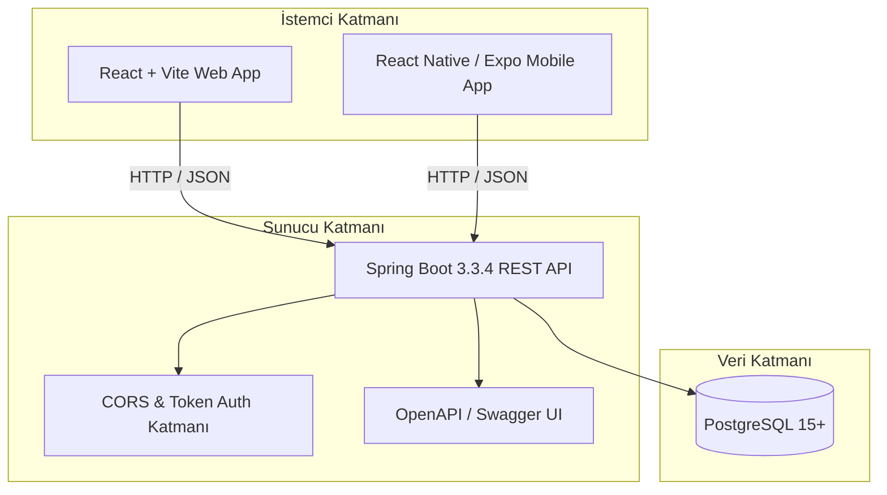

# 🍽️ GastroSync — Restoran İşletim & Maliyet Zekası Sistemi (OS)

[](https://react.dev/)
[](https://spring.io/)
[](https://www.postgresql.org/)
[](https://expo.dev/)
[](https://gastrosync.local)

**GastroSync**, modern restoranlar ve gastronomi işletmeleri için geliştirilmiş uçtan uca **İşletim & Maliyet Zekası (Food Cost Intelligence) Platformudur**. 

Reçete standardizasyonu, gerçek zamanlı hammadde gramaj takibi, kamera tabanlı optik barkod okuma ile mal kabul, zayiat/fire analitiği, dinamik rol bazlı yetkilendirme (RBAC) ve platforma özel mobil arayüzleri tek çatı altında sunar.

---

## 📌 İçindekiler
1. [Öne Çıkan Özellikler](#-öne-çıkan-özellikler)
2. [Sistem Mimarisi](#-sistem-mimarisi)
3. [Ekranlar ve Yetki Matrisi (RBAC)](#-ekranlar-ve-yetki-matrisi-rbac)
4. [Teknoloji Yığını](#-teknoloji-yığını)
5. [Kurulum & Çalıştırma Rehberi](#-kurulum--çalıştırma-rehberi)
6. [API Dokümantasyonu (Swagger)](#-api-dokümantasyonu-swagger)
7. [Mobil Uygulama Mimarisi](#-mobil-uygulama-mimarisi)
8. [Veritabanı Şeması](#-veritabanı-şeması)
9. [Katkıda Bulunma ve Lisans](#-katkıda-bulunma-ve-lisans)

---

## ✨ Öne Çıkan Özellikler

### 1. 🎯 Akıllı Food Cost & Kârlılık Zekası
- Her reçetenin porsiyon maliyeti gramaj seviyesinde otomatik hesaplanır.
- Hedeflenen ve gerçekleşen **Food Cost %** oranı anlık renkli göstergelerle (`%25 altı yeşil`, `%25-%35 arası sarı`, `%35 üstü kırmızı alarm`) izlenir.
- Toplam Ciro, Net Kâr, Brüt Kâr Marjı ve Toplam Zayiat Tutarı göstergeleriyle finansal şeffaflık sağlanır.

### 2. 📦 Mobil & Web Entegre Barkodlu Mal Kabul & Zayiat
- Cihaz kamerası kullanılarak **HTML5 optik barkod tarayıcı** (EAN-13, Code 128) ile temassız ürün okutma.
- Ürün gramaj/miktar girişi ile anında stok güncellemesi.
- Ezilme, kırık, son kullanma tarihi veya bozulma nedenleriyle **Zayiat Bildirimi** ve stoktan güvenli düşüm.

### 3. 👥 Dinamik Kullanıcı & Rol Yetkilendirme (RBAC)
- **Ana Yönetici (Admin)** kullanıcıları sistemden görevden alabilir, yeni personel ekleyebilir ve tek tıkla görev rolünü (Müdür, Şef, Depocu) anında güncelleyebilir.
- Yapılan değişiklikler doğrudan **PostgreSQL** veritabanına işlenir; sayfa yenilense de yetkiler kalıcıdır.
- Kullanıcılar ister **kullanıcı adı** ister **şirket e-postası / Gmail** ile sisteme giriş yapabilir.

### 4. 📊 Seviyeli Satış Analizi & Dışa Aktarma
- Sayfayı aşağı kaydırma zorunluluğunu ortadan kaldıran sekmeli (Tab) UX yapısı:
  - **Ürün Bazlı Satış Özeti**: Her yemeğin toplam porsiyon, ciro, maliyet ve food cost dengesi.
  - **Detaylı Satış Kaydı**: Zaman dilimlerine (Örn: `12:00-14:00`, `19:00-22:00`) göre gerçekleşen satışlar.
- **Tek Tıkla Raporlama**: Zümrüt yeşili temalı butonlarla tek tıkla **Excel (.xlsx)** ve **CSV** rapor çıktısı.

### 5. 🎨 Keyvo Mint & Emerald Kurumsal Tasarım Dili
- Modern gastronomi tasarımına uygun aydınlık mint-krem zemin (`#f2f9f5`), organik hareket eden animasyonlu yeşil balonlar (floating orbs), cam efektli (glassmorphism) bilgi kartları ve yüksek kontrastlı tipografi.

---

## 🏛️ Sistem Mimarisi



---

## 🔐 Ekranlar ve Yetki Matrisi (RBAC)

| Rol | Varsayılan Sayfa | Erişebildiği Modüller | Temel Yetkileri |
| :--- | :--- | :--- | :--- |
| **Sistem Yöneticisi (`ADMIN`)** | `/dashboard` | Tüm Sayfalar (Dashboard, Stok, Reçeteler, Satış, Depo, Kullanıcılar) | Personel ekleme, görevden alma, rol değiştirme, tam sistem kontrolü. |
| **İşletme Yöneticisi (`MANAGER`)** | `/dashboard` | Finansal Dashboard, Stok, Reçeteler, Satış Analizi | Finansal raporlama, ciro, food cost, kârlılık takibi ve Excel raporlama. |
| **Mutfak Şefi (`CHEF`)** | `/recipes` | Reçete Merkezi, Stok İzleme | Menü reçeteleri oluşturma, hammadde gramajı düzenleme, porsiyon maliyeti. |
| **Depo Sorumlusu (`WAREHOUSE`)** | `/warehouse` | Yalnızca Depo Mobil Terminali | Barkodla mal kabul, zayiat düşümü, depo mevcudu sayımı. |

> [!NOTE]  
> Depo sorumlusu haricindeki yöneticiler depo terminaline geçtiğinde yan menüleri kaybolmaz ve hesaptan çıkış butonları gizlenir; yöneticiler tek tıkla **"Panele Dön"** butonuyla yönetim ekranına geri dönebilirler.

---

## 💻 Teknoloji Yığını

- **Frontend Web**: React 19, Vite, Zustand (Global State), React Router DOM v7, React Icons, Canvas Confetti, SheetJS (XLSX), React Hot Toast.
- **Backend API**: Java 21, Spring Boot 3.3.4, Spring Data JPA, Hibernate, Tomcat Embedded, Springdoc OpenAPI 2.6 (Swagger UI).
- **Veritabanı**: PostgreSQL (Hibernate DDL Auto & Data Seeder).
- **Mobil**: React Native, Expo SDK, Platform Odaklı iOS & Android mimarisi.

---

## 🚀 Hızlı Başlangıç & Tek Tıkla Çalıştırma (All-in-One)

Projeyi indiren bir geliştiricinin saniyeler içinde tüm ekosistemi (Backend, Web, Mobil) canlı ve senkronize başlatması için hazır başlatıcılar eklenmiştir:

### 🟢 Windows İçin (Tek Tıkla Başlatma):
Klasör içerisindeki **`start-all.bat`** dosyasına çift tıklayın veya terminalden çalıştırın:
```cmd
start-all.bat
```
Bu betik:
1. `backend` dizininde Spring Boot sunucusunu (`:8080`) ve PostgreSQL bağlantısını açar.
2. `GastroSync` web arayüzünü (`:3000` / `:3001`) başlatır.
3. `mobile` dizininde Expo Metro sunucusunu ve mobil tüneli açar.

---

### 🍎 macOS / Linux İçin:
```bash
chmod +x start-all.sh
./start-all.sh
```

---

## 🛠️ Manuel Kurulum & Adım Adım Çalıştırma

### Gereksinimler
- **Node.js**: v18.0.0 veya üzeri ([İndir](https://nodejs.org/))
- **Java JDK**: 21 veya üzeri ([Eclipse Temurin / OpenJDK](https://adoptium.net/))
- **PostgreSQL**: v14 veya üzeri ([İndir](https://www.postgresql.org/download/))

---

### 1. Veritabanını Hazırlayın
PostgreSQL üzerinde `gastrosync` adında bir veritabanı oluşturun:
```sql
CREATE DATABASE gastrosync;
```
`backend/src/main/resources/application.properties` dosyasından şifrenizi kontrol edin (Varsayılan: `postgres` kullanıcısı).

### 2. Backend Sunucusunu Başlatın
```bash
cd backend
mvn spring-boot:run
```
> Sunucu **`http://localhost:8080`** portunda başlar. `DataSeeder` sınıfı örnek kullanıcıları, menü reçetelerini ve 21 hammaddeyi otomatik olarak veritabanına ekler.

### 3. Frontend Web Uygulamasını Başlatın
Yeni bir terminalde:
```bash
npm install
npm run dev
```
> Web arayüzü **`http://localhost:3000`** veya `http://localhost:3001` portunda açılır.

### 4. Mobil Uygulamayı Başlatın (Expo)
Yeni bir terminalde:
```bash
cd mobile
npm install
npx expo start --tunnel
```
> Terminaldeki QR kodu iOS için Kamera veya Android için Expo Go uygulaması ile okutarak test edebilirsiniz. Web ve Mobil aynı veritabanına bağlıdır; birinde yapılan stok veya yetki değişikliği diğerine canlı olarak yansır.

---

## 📖 API Dokümantasyonu (Swagger)

Backend çalışırken tüm REST API uç noktalarını tarayıcınızdan interaktif olarak test edebilirsiniz:
- **Swagger UI**: `http://localhost:8080/swagger-ui/index.html`
- **OpenAPI JSON**: `http://localhost:8080/v3/api-docs`

---

## 📱 Mobil Uygulama Mimarisi

Mobil katman, telefonların donanımsal alt tuşlarına bağımlılığı ortadan kaldıran dahili geri dönüş navigasyonuna ve platforma özel tasarım ilkelerine sahiptir:
- **Android Terminal**: `mobile/src/android/AndroidApp.js` (Material Design & floating actions)
- **iOS Terminal**: `mobile/src/ios/IOSApp.js` (Cupertino estetiği & blur bar)
- **Ortak Veri ve Token Sistemi**: `mobile/src/theme/tokens.js`

Mobil projeyi çalıştırmak için:
```bash
cd mobile
npm install
npx expo start
```

---

## 🔑 Varsayılan Demo Hesapları

| Kullanıcı Adı | E-posta | Varsayılan Şifre | Rol |
| :--- | :--- | :--- | :--- |
| `admin` | `admin@gastrosync.com` | `123456` | Sistem Yöneticisi |
| `manager` | `manager@gastrosync.com` | `123456` | İşletme Yöneticisi |
| `chef` | `chef@gastrosync.com` | `123456` | Mutfak Şefi |
| `warehouse` | `warehouse@gastrosync.com` | `123456` | Depo Sorumlusu |

---

## 📄 Lisans
Bu proje [MIT Lisansı](LICENSE) altında lisanslanmıştır.
GastroSync © 2026 Tüm Hakları Saklıdır.
