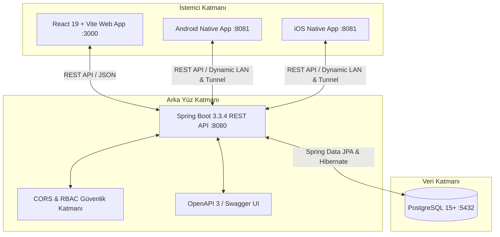

# 🍽️ GastroSync — Restoran İşletim, Kasa/Muhasebe & Maliyet Zekası Sistemi (OS)

[](https://react.dev/)
[](https://reactnative.dev/)
[](https://spring.io/)
[](https://www.postgresql.org/)
[](https://gastrosync.local)
[](https://gastrosync.local)

**GastroSync**, modern restoranlar, gastronomi işletmeleri ve çok şubeli gıda operasyonları için geliştirilmiş uçtan uca **İşletim, Kasa-Muhasebe, Mali Müşavir Onay ve Maliyet Zekası (Food Cost Intelligence) Ekosistemidir**. 

Reçete standardizasyonu, gerçek zamanlı hammadde gramaj takibi, optik kamera tabanlı barkodlu mal kabul, zayiat/fire analitiği, dinamik rol bazlı yetkilendirme (RBAC), restoran içi departman telsizi (Team Chat), kasa/nakit akışı yönetimi, resmi Mali Müşavir (SMMM) onay defteri ve hem Web hem de yerel **React Native (Android & iOS)** mobil arayüzlerini tek bir senkronize çatı altında birleştirir.

---

## 📌 İçindekiler
1. [Öne Çıkan Özellikler](#-öne-çıkan-özellikler)
2. [Ekranlar ve Rol Yetki Matrisi (RBAC)](#-ekranlar-ve-rol-yetki-matrisi-rbac)
3. [GastroSync Kasa & Mali Müşavir (SMMM) Modülü](#-gastrosync-kasa--mali-müşavir-smmm-modülü)
4. [Sistem Mimarisi](#-sistem-mimarisi)
5. [Mobil Uygulama Mimarisi (React Native)](#-mobil-uygulama-mimarisi-react-native)
6. [Çoklu Dil Desteği (i18n)](#-çoklu-dil-desteği-i18n)
7. [Teknoloji Yığını & GitHub Dil Dağılımı](#-teknoloji-yığını--github-dil-dağılımı)
8. [Hızlı Başlangıç & All-in-One Çalıştırma](#-hızlı-başlangıç--all-in-one-çalıştırma)
9. [Manuel Kurulum Rehberi](#-manuel-kurulum-rehberi)
10. [Varsayılan Demo Hesapları](#-varsayılan-demo-hesapları)
11. [Yakında Gelecek Özellikler (Roadmap)](#-yakında-gelecek-özellikler-roadmap)
12. [Lisans](#-lisans)

---

## ✨ Öne Çıkan Özellikler

### 1. 🎯 Akıllı Food Cost & Kârlılık Zekası
- Menüdeki tüm reçetelerin porsiyon maliyeti hammadde gramajı ve güncel toptancı birim fiyatları üzerinden otomatik hesaplanır.
- Hedeflenen ve gerçekleşen **Food Cost %** oranı renkli canlı göstergelerle (`%25 altı yeşil • Yüksek Kârlı`, `%25-%35 arası sarı • Dengeli`, `%35 üstü kırmızı • Kritik Maliyet`) anlık izlenir.
- Günlük Kasa Cirosu, Gerçekleşen Gıda Maliyeti, Faaliyet Kârı ve Zayiat Kayıpları şeffaf panellerde özetlenir.

### 2. 💰 Kasa & Muhasebe (Nakit Akışı & Borç Takibi)
- Restoranın günlük nakit, kredi kartı ve POS adisyon tahsilatları ile kasadan yapılan harcamalar tek ekranda takip edilir.
- **Sabit Giderler** (Kira, Personel Maaşı, Müşavir Aidatı) ve **Değişken Giderler** (Elektrik, Su, Doğalgaz, Sarf, SGK/Vergi) kategorize edilir.
- Kasadan fiilen ödenen giderler toptancı borçlarından anında düşülür, bekleyen vadeli borçlar alarm rozetleriyle listelenir.

### 3. 📖 Mali Müşavir (SMMM) Resmi Yevmiye Defteri
- Muhasebenin ve kasanın girdiği tüm faturalı/fişli giderler Mali Müşavir kontrol paneline düşer.
- Mali Müşavir giderleri tek tıkla **Resmi Deftere Onaylar** veya eksik evrak durumunda **Gerekçeli Ret** bildirimi gönderir.
- Muhasebe yazılımları için **Luca & Zirve Entegre Mahsup Fişi (.XML / .XLS)** ve **Gün Sonu Z-Raporu Mutabakatı** altyapısı mevcuttur.

### 4. 🧭 Finansal Rubrik Soruları & Kasa Teşhisi
- İşletme sahipleri ve yöneticiler için sık sorulan 4 kritik soruya otomatik yanıt veren canlı karne:
  1. *Bugün ne satıldı ve ne kadar gelir sağlandı?*
  2. *Gerçek net kâr ve hammadde maliyeti nedir?*
  3. *Kasada bekleyen borçlar ve vadeli harcamalar ne durumda?*
  4. *Mali Müşavir denetiminde reddedilen veya bekleyen var mı?*

### 5. 📻 Restoran İçi Departman Telsizi & Ekip Sohbeti (Team Chat)
- Salon, Mutfak, Kasa ve Yönetim arasında anlık haberleşme kanalları (`#genel`, `#mutfak`, `#kasa`, `#yonetim`).
- Acil durum anonsları (Örn: `🚨 Acil Stok / Malzeme Uyarısı`), kasa ödemesi bildirimi ve vardiya notları.

### 6. 📦 Barkodlu Mal Kabul & Zayiat Terminali (Web & Mobil)
- Cihaz kamerası (iOS & Android Expo Camera) ve Web vizörü ile temassız optik EAN-13 / Code 128 barkod tarama.
- Barkodsuz ürünler için klavyeden hızlı arama.
- Mal kabul ile anında stok artışı; bozulma, kırık veya SKT geçmesi durumunda gerekçeli **Zayiat / Fire Kaydı**.

### 7. 👥 Dinamik Kullanıcı Yönetimi & Güçlü Yetkilendirme (RBAC)
- 6 farklı sektör rolü (**Yönetici, Müdür, Kasa/Muhasebe, Mali Müşavir, Mutfak Şefi, Depo Sorumlusu**).
- Süper Yönetici tarafından tek tıkla şifre belirleme, rol değiştirme ve görevden alma; PostgreSQL ile kalıcı yetki senkronizasyonu.
- Yetkisiz sayfalara girişlerde özel **403 Güvenlik İhlal Paneli** ve otomatik yöneticiye ihlal bildirimi.

### 8. 🌍 Uluslararası 4 Dilli Altyapı (i18n)
- **Türkçe (TR)**, **İngilizce (EN)**, **Almanca (DE)** ve **Arapça (AR)** desteği.
- Kategoriler, roller, filtreler, modal pencereler ve finansal metrikler dahil %100 eksiksiz sözlük mimarisi.

---

## 🔐 Ekranlar ve Rol Yetki Matrisi (RBAC)

| Rol Adı | Kod | Varsayılan Sayfa | Erişebildiği Modüller & Arayüzler |
| :--- | :--- | :--- | :--- |
| **Sistem Yöneticisi (Super Admin)** | `ADMIN` | `/dashboard` | Tüm Ekranlar (Yönetim Paneli, Kasa, Müşavir Defteri, Stok, Reçeteler, Satış, Depo, Kullanıcılar, Telsiz) |
| **İşletme Yöneticisi (Müdür)** | `MANAGER` | `/dashboard` | Finansal Dashboard, Kasa Takibi, Stok, Reçeteler, Satış Analizi, Departman Telsizi |
| **Muhasebeci (Kasa)** | `ACCOUNTANT` | `/accounting` | Kasa & Nakit Akışı, Gider Ekleme, Toptancı Borç Ödeme, Z Raporu, Günlük Ciro |
| **Mali Müşavir (SMMM)** | `FINANCIAL_ADVISOR` | `/advisor-ledger` | Resmi Defter Onayı, Gerekçeli Ret, TDHP Hesap Planı, Luca/Zirve Aktarımı |
| **Mutfak Şefi (Chef)** | `CHEF` | `/recipes` | Reçete Merkezi, Gramaj & Porsiyon Maliyeti, Depo Stok İzleme, Mutfak Telsizi |
| **Depo Sorumlusu** | `WAREHOUSE` | `/warehouse` | Barkodlu Mal Kabul Terminali, Zayiat/Fire Girişi, Manuel Arama, Depo Telsizi |

---

## 💼 GastroSync Kasa & Mali Müşavir (SMMM) Modülü

Web ve Mobilde tam senkronize çalışan muhasebe modülü, geleneksel POS yazılımlarının aksine doğrudan maliyet ve yevmiye süreçlerine odaklanır:

```
[POS & Adisyon Satışı] ──► [Kasa Geliri (Ciro)]
                                │
[Depo Mal Kabul Faturası] ──────┼──► [Kasa Ödemesi / Borç Takibi]
                                │               │
                                ▼               ▼
                      [Net Faaliyet Kârı]   [Mali Müşavir İnceleme]
                                                ├──► [✓ Resmi Deftere Onay]
                                                └──► [❌ Gerekçeli Ret & Revize]
```

- **Mali Müşavir Onay Süreci:** Kasadan ödenen toptancı veya operasyon gideri *"Müşavir Defterine İlet"* butonuyla SMMM paneline aktarılır. Müşavir evrakları inceler, tek tıkla onaylar veya gerekçe belirterek reddeder.
- **Canlı Finansal Bilanço:** `Toplam Ciro - (Hammadde Maliyeti + Sabit Giderler + Değişken Giderler) = Net İşletme Faaliyet Kârı`.
- **Dışa Aktarma:** Muhasebe tabloları tek tıkla **Excel (.xlsx)** ve **CSV** formatında indirilebilir.

---

## 🏛️ Sistem Mimarisi



---

## 📱 Mobil Uygulama Mimarisi (React Native)

GastroSync mobil uygulaması **React Native & Expo** üzerinde native mobil bileşenlerle geliştirilmiştir. Web arayüzünün basit bir WebView sarmalayıcısı değil, **tamamen yerel (native) performanslı** bir mobil istemcidir:

- **Platform Odaklı İkiz Mimari:**
  - **Android (`mobile/src/android/AndroidApp.js`):** Material Design kartları, dinamik alt güvenli alan (`insets.bottom`), kaydırmalı sekmeler ve yerel Android geri tuşu optimizasyonu.
  - **iOS (`mobile/src/ios/IOSApp.js`):** Cupertino estetiği, cam efektli başlıklar ve dinamik ada/çentik (`insets.top`) uyumu.
- **Kamera Barkod Okuyucu (`mobile/src/components/CameraScanner.js`):** Telefon kamerasını doğrudan kullanarak depoda barkod okuma imkanı sunar.
- **Dahili Geri Navigasyonu (`← Geri`):** Donanımsal tuşlara bağımlılığı kaldıran, yığın (stack) tabanlı yerel geri tuşu mekanizması.
- **Metin Taşma & Dar Ekran Koruması:** Türkçe ve diğer dillerde başlıkların kutulardan taşmasını engelleyen `adjustsFontSizeToFit` ve `numberOfLines={1}` optimizasyonları.

---

## 🌍 Çoklu Dil Desteği (i18n)

Sistem `src/utils/translations.js` (Web) ve `mobile/src/data/translations.js` (Mobil) sözlükleri üzerinden tek merkezden yönetilir:

| Dil | Kod | Kapsam |
| :--- | :--- | :--- |
| **Türkçe** | `tr` | Varsayılan dil; tüm ekranlar, TDHP hesapları ve yasal bildirimler |
| **İngilizce** | `en` | Uluslararası restoran yönetimi ve POS terminolojisi |
| **Almanca** | `de` | Avrupa gastronomi standartları ve GuV muhasebe terimleri |
| **Arapça** | `ar` | Körfez ve Orta Doğu restoran zincirleri için RTL uyumlu çeviriler |

Kullanıcı arayüzün sağ üst köşesindeki dil seçiciye dokunduğunda tüm menüler, butonlar, placeholder'lar ve finansal tablolar sayfa yenilenmeden anında değişir.

---

## 💻 Teknoloji Yığını & GitHub Dil Dağılımı

### Teknoloji Bileşenleri
- **Frontend Web:** React 19, Vite, Zustand, React Router DOM v7, React Icons, Canvas Confetti, SheetJS (XLSX), React Hot Toast.
- **Mobil:** React Native, Expo SDK 52, Expo Camera, React Native Safe Area Context.
- **Backend:** Java 21, Spring Boot 3.3.4, Spring Data JPA, Hibernate, Tomcat Embedded, Springdoc OpenAPI 2.6 (Swagger UI).
- **Veritabanı:** PostgreSQL 15+ (Hibernate DDL Auto & Data Seeder).
- **Tasarım:** Keyvo Mint & Emerald Custom Vanilla CSS Design System (Sıfır ağır CSS framework bağımlılığı).

### 🏷️ GitHub Dil Dağılımı Notu (.gitattributes)
> Repo içerisinde hem **React Native** (mobil), hem **React Web**, hem de **Java Spring Boot** backend bulunmaktadır. GitHub Linguist istatistiklerinde projenin yalnızca yalın JavaScript olarak görünmemesi; kök dizindeki yardımcı scriptlerin (`seed-recipes.js`, `compile_backend.ps1` vb.) hariç tutulması ve mobil projenin React Native kimliğinin doğru algılanması için `.gitattributes` yapılandırması projeye eklenmiştir.

---

## 🚀 Hızlı Başlangıç & All-in-One Çalıştırma

Projeyi klonlayan bir geliştiricinin saniyeler içinde tüm ekosistemi (Backend, Web, Mobil) canlı başlatabilmesi için tek tıkla çalıştırıcılar hazırlanmıştır:

### 🟢 Windows (Tek Tıkla Başlatma):
Klasör içerisindeki **`start-all.bat`** dosyasına çift tıklayın veya CMD/PowerShell üzerinden çalıştırın:
```cmd
start-all.bat
```
Bu betik sırasıyla:
1. `backend` dizininde gömülü Maven ile Spring Boot API sunucusunu (`:8080`) ayağa kaldırır.
2. `GastroSync` React Web arayüzünü (`:3000`) başlatır.
3. `mobile` dizininde Expo Metro sunucusunu ve mobil tüneli açar.

### 🍎 macOS / Linux:
```bash
chmod +x start-all.sh
./start-all.sh
```

---

## 🛠️ Manuel Kurulum Rehberi

### Gereksinimler
- **Node.js**: v18.0.0 veya üzeri ([İndir](https://nodejs.org/))
- **Java JDK**: 21 veya üzeri ([Eclipse Temurin / OpenJDK](https://adoptium.net/))
- **PostgreSQL**: v14 veya üzeri ([İndir](https://www.postgresql.org/download/))

### 1. Veritabanını Oluşturun
PostgreSQL'de `gastrosync` isimli bir veritabanı açın:
```sql
CREATE DATABASE gastrosync;
```
*(Gerekirse `backend/src/main/resources/application.properties` içindeki şifreyi kendi PostgreSQL şifrenizle güncelleyin).*

### 2. Backend API'yi Başlatın
```bash
cd backend
mvn spring-boot:run
```
> Sunucu **`http://localhost:8080`** üzerinde başlar. `DataSeeder` sınıfı 6 farklı roldeki demo kullanıcıları, 9 reçeteyi ve 21 hammaddeyi otomatik olarak veritabanına yükler.
> - **Swagger UI Dokümantasyonu:** `http://localhost:8080/swagger-ui/index.html`

### 3. Frontend Web Uygulamasını Başlatın
Ana dizinde yeni bir terminal açın:
```bash
npm install
npm run dev
```
> Web arayüzü **`http://localhost:3000`** üzerinde açılır.

### 4. React Native Mobil Uygulamayı Başlatın (Expo)
Yeni bir terminalde:
```bash
cd mobile
npm install
npx expo start --tunnel
```
> Terminaldeki QR kodu iOS'ta Kamera, Android'de Expo Go uygulaması ile okutarak telefonunuzda test edebilirsiniz.

---

## 🔑 Varsayılan Demo Hesapları

Sisteme giriş yapabileceğiniz hazır roller (Tüm hesapların şifresi `123456`'dır):

| Kullanıcı Adı | E-posta | Rol | Açıklama |
| :--- | :--- | :--- | :--- |
| **`admin`** | `admin@gastrosync.com` | Süper Yönetici | Tüm sistem, kullanıcı yetkilendirme ve raporlar |
| **`manager`** | `manager@gastrosync.com` | İşletme Müdürü | Satış, maliyet ve operasyon yönetimi |
| **`accountant`** | `muhasebe@gastrosync.com` | Kasa & Muhasebe | Nakit akışı, gider ödeme, borç takibi, Z-Raporu |
| **`advisor`** | `musavir@gastrosync.com` | Mali Müşavir (SMMM) | Resmi yevmiye defteri onayı, Luca/Zirve entegrasyonu |
| **`chef`** | `chef@gastrosync.com` | Mutfak Şefi | Reçete gramajları, porsiyon maliyeti ve tüketim |
| **`warehouse`** | `depo@gastrosync.com` | Depo Sorumlusu | Barkodlu mal kabul, zayiat ve stok sayımı |


## 📄 Lisans
Bu proje [MIT Lisansı](LICENSE) altında lisanslanmıştır.  
GastroSync © 2026 Tüm Hakları Saklıdır.
Geliştirici - Ecren Solmazgül
