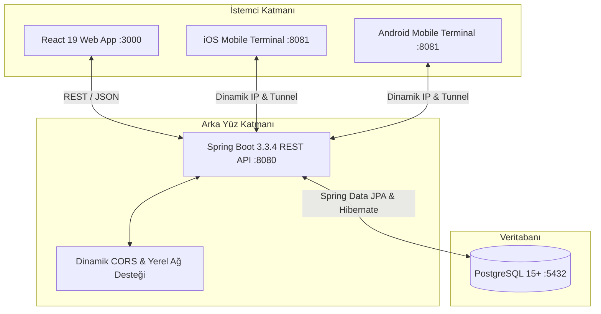

# 📚 GastroSync — Geliştirici & Sistem Mimarisi Wiki Rehberi

Bu wiki belgesi, **GastroSync Restoran İşletim & Maliyet Zekası** sisteminin uçtan uca mimarisini, web ve mobil canlı senkronizasyon protokolünü, algoritmalarını ve iş akışlarını ayrıntılı olarak açıklamaktadır.

---

## 📑 İçindekiler
1. [Sistem Mimarisi & Canlı Senkronizasyon](#1-sistem-mimarisi--canlı-senkronizasyon)
2. [Hızlı Başlangıç (All-in-One Başlatıcı)](#2-hızlı-başlangıç-all-in-one-başlatıcı)
3. [Food Cost Hesaplama Mantığı ve Matematiksel Modeli](#3-food-cost-hesaplama-mantığı)
4. [Rol Tabanlı Erişim Kontrolü (RBAC) ve Güvenlik](#4-rol-tabanlı-erişim-kontrolü-rbac)
5. [Mobil & Web Depo Barkod Mal Kabul / Zayiat Döngüsü](#5-mobil--web-depo-barkod-mal-kabul--zayiat-döngüsü)
6. [Satış & POS Analitiği](#6-satış--pos-analitiği)
7. [Dizayn Sistemi & Keyvo Mint-Emerald Kurumsal Teması](#7-dizayn-sistemi--keyvo-mint-emerald-kurumsal-teması)
8. [Hata Giderme & Sıkça Sorulan Sorular (Troubleshooting)](#8-hata-giderme--sıkça-sorulan-sorular-troubleshooting)

---

## 1. Sistem Mimarisi & Canlı Senkronizasyon

GastroSync, tek bir merkezi PostgreSQL veritabanına bağlı çok platformlu bir ekosistemdir:



### Çift Yönlü Kalıcılık Kuralları:
1. **Mobilden Web'e Yansıma:** Mobilde kamera ile okutulan veya seçilen bir hammaddeye mal kabul (`POST /api/inventory/{id}/receive`) veya fire (`/waste`) işlemi yapıldığında, işlem PostgreSQL'e kaydedilir. Web arayüzü listeyi yenilediğinde güncel stoğu ve denetim logunu anında görür.
2. **Web'den Mobil'e Yansıma:** Web yöneticisi bir personelin rolünü değiştirdiğinde (`PUT /api/users/{id}/role`) veya yeni bir ürün eklediğinde, mobil uygulama `apiFetchInventory` ve `apiFetchUsers` ile veriyi anında çeker.
3. **Optimistic UI & Fallback:** İnternet veya backend geçici olarak kesilirse mobil uygulama akışı bozmaz, kullanıcıya anında görsel yanıt verir ve arka planda servise bağlanmayı dener.

---

## 2. Hızlı Başlangıç (All-in-One Başlatıcı)

Dışarıdan bir geliştirici depoyu indirdiğinde:
- **Windows:** Kök dizindeki `start-all.bat` dosyasına çift tıklaması yeterlidir. Sistem gömülü Maven'ı (`backend/maven/apache-maven-3.9.9`) otomatik algılar, Spring Boot'u, Web uygulamasını ve Expo Mobil Tünelini aynı anda başlatır.
- **macOS / Linux:** `chmod +x start-all.sh && ./start-all.sh` komutu ile tüm servisler tek pencerede ayağa kalkar.

---

## 3. Food Cost Hesaplama Mantığı

Restoran sektörünün en kritik kârlılık metriği olan **Food Cost Oranı (Yemek Maliyeti Yüzdesi)**, GastroSync içerisinde hammadde reçete maliyetleri üzerinden dinamik olarak hesaplanır:

### Formül:
$$\text{Reçete Maliyeti} = \sum_{i=1}^{n} (\text{Malzeme Miktarı}_i \times \text{Birim Fiyatı}_i)$$

$$\text{Food Cost \%} = \left( \frac{\text{Reçete Maliyeti}}{\text{Menü Satış Fiyatı}} \right) \times 100$$

### Kâr Gösterge Renkleri:
- **Yeşil (`Food Cost <= %25`)**: Yüksek kârlı ürün. Restoran için en ideal segment.
- **Sarı (`%25 < Food Cost <= %35`)**: Standart ve dengeli yemek maliyeti.
- **Kırmızı (`Food Cost > %35`)**: Yüksek maliyetli veya porsiyon gramajı gözden geçirilmesi gereken ürün.

---

## 4. Rol Tabanlı Erişim Kontrolü (RBAC)

GastroSync, yetkisiz veri erişimini hem **İstemci (React ProtectedRoute & Mobile ROLE_ALLOWED_SCREENS)** hem de **Sunucu (Spring Boot API)** katmanında denetler:

| Rol | Yetkili Modüller | Rol Geçiş Kuralı |
| :--- | :--- | :--- |
| **Sistem Yöneticisi (`ADMIN`)** | Tüm Sayfalar (Dashboard, Stok, Reçete, Satış, Depo, Kullanıcılar) | Tam Yetki, Rol Atama, Personel Çıkarma |
| **İşletme Yöneticisi (`MANAGER`)** | Finansal Dashboard, Stok, Reçeteler, Satış Analizi | Raporlama, Excel/CSV Çıktısı |
| **Mutfak Şefi (`CHEF`)** | Reçete Merkezi, Stok İzleme | Reçete tasarımı, gramaj düzenleme |
| **Depo Sorumlusu (`WAREHOUSE`)** | Yalnızca Depo Terminali | Barkodla mal kabul, zayiat düşümü |

> **Kural:** Güvenlik gereği roller arası anlık profil atlaması yasaktır. Bir kullanıcı ekranını değiştirecekse önce çıkış yapar ve kendi yetkili hesabı ile giriş yapar.

---

## 5. Mobil & Web Depo Barkod Mal Kabul / Zayiat Döngüsü

### Kamera Tabanlı Tarama:
- **Web:** `Html5BarcodeScanner.jsx` bileşeni üzerinden kamera vizörü ve lazer kılavuz çizgisi ile EAN-13 / Code 128 okur.
- **Mobil (iOS & Android):** `CameraScanner.js` ve Expo Camera modülü ile telefonun optik kamerasını açar, tarama yapıldığında hammaddeyi anında bulur.

### Mal Kabul & Zayiat İşlemi:
- Miktar girilip **Mal Kabul Et** dendiğinde stok artar ve maliyet kaydı düşülür.
- **Zayiat / Fire** dendiğinde stoktan düşülür, fire nedeni (Son Kullanma Tarihi, Ezilme vb.) loglanır.

---

## 6. Satış & POS Analitiği

GastroSync Satış Analizi ekranı iki temel görünüm sunar:
1. **Ürün Bazlı Satış Özeti**: Menüdeki her yemeğin gün içindeki porsiyon satışı, brüt gelir, toplam maliyet ve net kârı.
2. **Detaylı Satış Kaydı (Zaman Dilimlerine Göre)**: Öğle servisi (`12:00-14:00`), Akşam servisi (`19:00-22:00`) ve Sabah servisi kırılımları.
3. **Rapor İndirme**: Tek tıkla Excel (`.xlsx`) ve `.csv` çıktısı alınabilir.

---

## 7. Dizayn Sistemi & Keyvo Mint-Emerald Kurumsal Teması

Tüm web ve mobil platformlarda aynı kurumsal kimlik uygulanmıştır:
- **Arka Plan Rengi**: `#f2f9f5` (Aydınlık mint-krem).
- **Vurgu & Aksiyon Rengi**: `#047857` (Zümrüt Yeşili) ve `#10b981` (Canlı Emerald).
- **Metin Renkleri**: `#062612` (Koyu orman yeşili) ve `#64748b` (Alt etiketler).
- **Mobil Uyum**: Android sanal alt butonlarının üzerine binmeyi engelleyen dinamik güvenli alan (`insets.bottom`), iOS için Cupertino sekme çubuğu ve donanımsal geri tuşuna bağımlı kalmayan dahili `← Geri` navigasyonu.

---

## 8. Hata Giderme & Sıkça Sorulan Sorular (Troubleshooting)

### S1: Mobilden mal kabul yaptığımda webde hemen görünmüyor ne yapmalıyım?
Backend sunucusunun (`:8080`) ayakta olduğundan emin olun. Telefonunuz ve bilgisayarınız aynı Wi-Fi ağına bağlı olduğunda veya Expo tüneli açık olduğunda işlemler doğrudan PostgreSQL veritabanına yazılır. Web sayfasındaki **Listeyi Yenile** butonuna basarak güncel veriyi anında görebilirsiniz.

### S2: Port 8080 dolu hatası alıyorum:
PowerShell üzerinden şu komutla portu boşaltabilirsiniz:
```powershell
Get-Process -Id (Get-NetTCPConnection -LocalPort 8080).OwningProcess | Stop-Process -Force
```

### S3: PostgreSQL bağlantı hatası alıyorum:
`backend/src/main/resources/application.properties` içindeki şifrenizi kontrol edin ve veritabanının açık olduğunu doğrulayın:
```powershell
Get-Service -Name postgresql*
```
